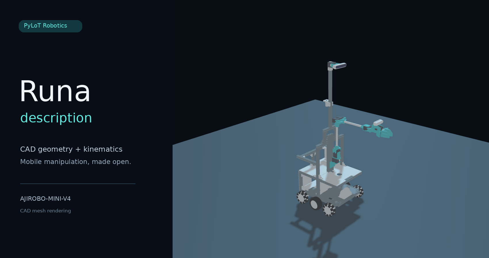
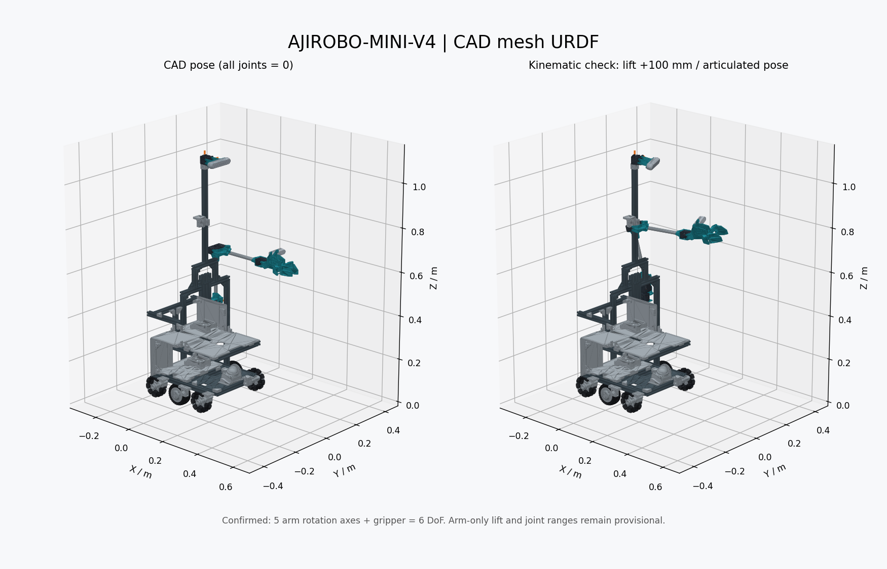

# Runa_description

ROS 2 description of **Runa**, PyLoT Robotics' mobile manipulator.
ROS package: `runa_description`. Target: Ubuntu 24.04 / ROS 2 Jazzy.

This is the **AJIROBO-MINI-V4 v11 CAD mesh model** supplied for Runa: a
23-link / 22-joint robot with five arm rotation axes plus a gripper, arm-only lift,
pan/tilt head, head D455 and wrist D435i RGB-D camera. A 95-link detailed variant adds
72 passive omni-wheel rollers. Meshes are in metres and link-local coordinates.

`urdf/runa_cad.urdf` preserves the reviewed CAD model's geometry, axes, transforms,
joint names and provisional limits (only the package URI / robot name changes).
The simulator uses `runa_physics.urdf`: identical CAD visuals/transforms with
explicit API joint-name aliases, approximate inertias and collision proxies.
These are not measured dynamics. CAD zero is the saved CAD pose, **not a calibrated
hardware encoder zero**. Arm-only lift scope, travel limits, gripper transmission
and camera extrinsics still require hardware confirmation.

## Install and display

```bash
source /opt/ros/jazzy/setup.bash
sudo apt install ros-jazzy-xacro ros-jazzy-robot-state-publisher \
  ros-jazzy-joint-state-publisher-gui ros-jazzy-rviz2
mkdir -p ~/runa_ws/src
cd ~/runa_ws/src
git clone https://github.com/PyLoT-Robotics/Runa_description.git
cd ~/runa_ws
colcon build --symlink-install --packages-select runa_description
source install/setup.bash
ros2 launch runa_description display.launch.py
```

Use `gui:=false rviz:=false` for robot_state_publisher only; in that mode another
node must supply joint states. Display launch never starts a serial driver.

## Frames and joints

| Component | Names / units |
|---|---|
| Root / body | `base_footprint` → `base_link` (axle centre, z=0.05035 m) |
| Drive | `left_wheel_joint`, `right_wheel_joint`; CAD radius 0.05035 m, track 0.345 m |
| Passive support | Four `*_omni_joint` joints; optional 72 roller joints |
| Head | `head_pan_joint`, `head_tilt_joint`; radians |
| Arm | `arm_joint_1`–`arm_joint_5`; radians |
| Gripper | `gripper_joint`, `right_finger_joint` (mimic); provisional 0–0.015 m per finger |
| Lift | `lift_joint`; provisional 0–0.20 m, arm and mounting plate only |
| Camera optical | `head_camera_optical_frame`, `wrist_camera_optical_frame` |
| Tool | `tool0` |

All joints at zero reproduce the CAD's saved pose. The body, head mast and head
camera remain fixed relative to the base while the arm lift moves. The real lift
is a stepper-driven ball screw operated with position commands.
`config/drive_geometry.yaml` records the CAD nominal drive geometry.
The source URDFs have no measured inertias or hardware drivers.

## Simulation aliases and fidelity

The physics variant keeps the original link names and all visual geometry and
joint origins/axes. It deliberately changes the following joint names for client
compatibility:

| CAD joint | Simulation alias |
|---|---|
| `arm_joint_1` … `arm_joint_5` | `joint1` … `joint5` |
| `gripper_joint` | `gripper_left_joint` |
| `right_finger_joint` | `gripper_right_joint` |
| `head_pan_joint`, `head_tilt_joint` | `base_to_pan_joint`, `pan_to_tilt_joint` |

Simulation-only aliases also expose `tcp`, RealSense optical frame names and
approximate `laser`, `livox_frame`, `bno055_link` mounts. LiDAR/IMU placements are
integration assumptions, not measured CAD sensor extrinsics. The physics variant
adds estimated masses/inertias, conservative box/cylinder collision proxies and
low-friction spherical contacts for passive omni support. It does not model all
72 rollers in physics. Effort/velocity values are simulator tuning, not motor specs.
Gripper commands above 0.015 m exceed the reviewed CAD's provisional range.

## CAD preview



## Gazebo Harmonic

Use [Runa_sim](https://github.com/PyLoT-Robotics/Runa_sim) for simulation.
Its launch expands this model with `sim:=true` and an absolute `controllers_file`.
Default `sim:=false` displays the reviewed CAD mesh URDF and keeps this package independent of Gazebo and ros2_control.
The optional detailed roller model is `urdf/runa_cad_rollers.urdf`.
The simulator supplies physical controllers, RGB-D/LiDAR/IMU sensors and ROS bridges.

## Validation

After building and sourcing the workspace:

```bash
python3 -m pytest -q src/Runa_description/test
xacro src/Runa_description/urdf/runa.urdf.xacro > /tmp/runa.urdf
```

`scripts/generate_physics.py` regenerates the approximate physics variant from the
reviewed CAD URDF. It requires NumPy and leaves the CAD source untouched.

Tests check a single connected tree, mesh references, CAD joint limits, mimic
joints, absence of hardware plugins, and preservation of CAD visuals/transforms
in the physics variant. They do not establish calibrated dynamics or collision-free
hardware travel.

## License

[Apache-2.0](LICENSE).

## Acknowledgements

Thanks to PyLoT Robotics contributors for Runa's mechanical and ROS work, and to
the ROS / Gazebo communities. The companion simulation uses the
[PyLoT fork of SOBITS Gazebo Worlds](https://github.com/PyLoT-Robotics/sobits_gazebo_worlds),
originally developed by [TeamSOBITS](https://github.com/TeamSOBITS/sobits_gazebo_worlds)
under BSD-3-Clause. World assets remain in that dependency and retain their own terms.
